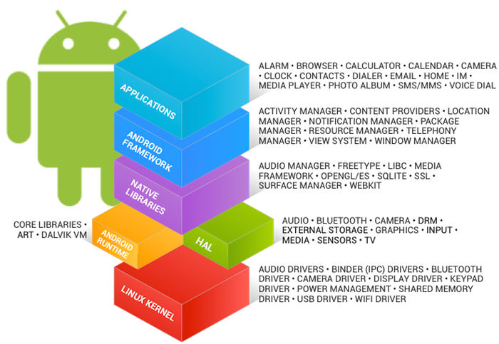

# Welcome to the Android Open Source Project!

Android is an open-source software stack for a wide range of mobile devices and a corresponding open-source project led by Google. Here you can find the information and source code you need to learn more about the Android platform. From there you can create custom variants of the Android software stack, port devices and accessories to the Android platform, and ensure your devices are compatible with the Android compatibility definition.



## In this document

This section describes how to set up your local work environment to build the Android source files. You will need to use Linux or Mac OS. Building under Windows is not currently supported.

For an overview of the entire code-review and code-update process, see [Life of a Patch](life-of-a-patch.html).

## Choosing a Branch

Some of the requirements for your build environment are determined by which version of the source code you plan to compile. See [Build Numbers](build-numbers.html) for a full listing of branches you may choose from. You may also choose to download and build the latest source code (called `master`), in which case you will simply omit the branch specification when you initialize the repository.

Once you have selected a branch, follow the appropriate instructions below to set up your build environment.

## Setting up a Linux build environment

These instructions apply to all branches, including `master`.

## Meet hardware requirements

Your development workstation should meet or exceed these hardware requirements:

* A 64-bit x86 system.

  **Note:** You can compile AOSP versions previous to 2.3.x on 32-bit systems.

* At least 400 GB of free disk space to check out and build the code (250 GB to check out + 150 GB to build).

  **Note:** If you're checking out a mirror, you need more space because the full Android Open Source Project (AOSP) mirrors contain all Git repositories that have ever been used.

* A minimum of 64 GB of RAM. Google uses 72-core machines with 64 GB of RAM to build Android. With this hardware configuration, it takes approximately 40 minutes for a full build of Android and only a few minutes for incremental build of Android. By contrast, it takes approximately 6 hours for a full build with a 6-core machine with 64 GB of RAM.

## Meet operating system requirements

Your development workstation must run any 64-bit Linux distribution with GNU C Library (glibc) 2.17 or later.

**Warning:** Android OS development on macOS isn't supported as of June 22, 2021 (Android 11). For information on configuring your development workstation for macOS, refer to [Set Up for AOSP development (2.3 - 8.0)](https://source.android.com/docs/setup/start/older-versions).

## Install required packages

To build Android 11 or higher, you must use Ubuntu 18.04 or later. To install required packages for Ubuntu 18.04 or later, run the following command:

 

```css
sudo apt-get install git-core gnupg flex bison build-essential zip curl zlib1g-dev libc6-dev-i386 x11proto-core-dev libx11-dev lib32z1-dev libgl1-mesa-dev libxml2-utils xsltproc unzip fontconfig
```

Among the packages installed, this command installs Git, which is used to download the AOSP source.

**Note:** This command works for Ubuntu 18.04 or later. For package installation for earlier versions of Ubuntu, see [Setup for Android development (AOSP 2.3 - 8)](https://source.android.com/docs/setup/start/older-versions).

## Install required software

Before you can work with AOSP, you must have installations of OpenJDK, Make, Python 3, and Repo. The latest release branch of Android comes with prebuilt versions of OpenJDK, Make, and Python 3, so additional installation steps aren't required. The following section explains how to install Repo.

### Install Repo

Follow these steps to install Repo:

1. Download the current package information:

    

   ```css
   sudo apt-get update
   ```

2. Run the following command to install the Repo launcher:

    

   ```css
   sudo apt-get install repo
   ```

   The Repo launcher provides a Python script that initializes a checkout and downloads the full Repo tool.

   If successful, skip to step 4.

3. Optional: Manually install Repo using the following series of commands:

    

   ```css
   export REPO=$(mktemp /tmp/repo.XXXXXXXXX)
   ```

   ```css
   curl -o ${REPO} https://storage.googleapis.com/git-repo-downloads/repo
   ```

   ```css
   gpg --recv-keys 8BB9AD793E8E6153AF0F9A4416530D5E920F5C65
   ```

   ```css
   curl -s https://storage.googleapis.com/git-repo-downloads/repo.asc | gpg --verify - ${REPO} && install -m 755 ${REPO} ~/bin/repo
   ```

   The first three commands set up a temp file, download Repo to the file, and verify that the key provided matches the required key. If these commands are successful, the final command installs the Repo launcher.

4. Verify the Repo launcher version:

    

   ```css
   repo version
   ```

   The output should indicate a version of 2.4 or higher, for example:

    

   ```css
   repo launcher version 2.45
   ```

## Set an alternative output directory

By default, the output of each build is stored in the `out/` subdirectory of the matching source tree. You can override this directory by exporting the `OUT_DIR` environment variable. For example, if you want to store your output on a different drive, you can point `OUT_DIR` to that drive:

 

```css
export OUT_DIR=my_other_drive
```

### Configuring USB Access

Under GNU/Linux systems (and specifically under Ubuntu systems), regular users can't directly access USB devices by default. The system needs to be configured to allow such access.

The recommended approach is to create a file `/etc/udev/rules.d/51-android.rules` (as the root user) and to copy the following lines in it. `<username>` must be replaced by the actual username of the user who is authorized to access the phones over USB.

```css
wget https://raw.githubusercontent.com/M0Rf30/android-udev-rules/refs/heads/main/51-android.rules && sudo mv 51-android.rules /etc/udev/rules.d/
```

Those new rules take effect the next time a device is plugged in. It might therefore be necessary to unplug the device and plug it back into the computer.

## Initializing a Repo client

After installing Repo, set up your client to access the Android source repository:

1. Create an empty directory to hold your working files. Give it any name you like:

   $ mkdir WORKING_DIRECTORY $ cd WORKING_DIRECTORY

2. Run `repo init` to bring down the latest version of Repo with all its most recent bug fixes. You must specify a URL for the manifest, which specifies where the various repositories included in the Android source will be placed within your working directory.

   To check out a branch other than "master", specify it with `-b`. For a list of branches, see [Source Code Tags and Builds](#).

   ```css
   repo init -u https://github.com/hy300projector/android -b android-14.0.0_r13
   ```

3. When prompted, configure Repo with your real name and email address. To use the Gerrit code-review tool, you will need an email address that is connected with a [registered Google account](https://www.google.com/accounts). Make sure this is a live address at which you can receive messages. The name that you provide here will show up in attributions for your code submissions.
